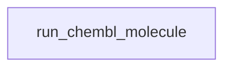

# Workflow run report: chembl_molecule

- **workflow_run_id:** `0b68c9b0-17a2-5f2b-ad4c-f5056820fdce`
- **status:** success
- **extracted total:** 1000
- **resumed:** False
- **fingerprint:** `5f38e124d02f304dc0e3f493788be09620d46a3471202cd4046f9b12632ad820`
- **duration_seconds:** 42.60838079999667

## Steps

| Step | Pipeline | Status | Extracted | Silver | Gold | Report |
|------|----------|--------|----------:|-------:|-----:|--------|
| run_chembl_molecule | chembl_molecule | success | 1000 | 1000 | 1000 | `…` |
  - report: `D:\github\BioactivityDataAcquisition\data\chembl-molecule-recovery-20261119\live\reports\pipeline\chembl_molecule\3f634546-3144-5462-9b0b-62c2ce411ccc\pipeline-run-report.json`

## Plan / DAG

- `run_chembl_molecule` (pipeline) depends_on: —

## Totals

- planned: 1
- succeeded: 1
- failed: 0
- skipped: 0
- records_extracted_sum: **1000**
- records_silver_sum: **1000**
- records_gold_sum: **1000**
