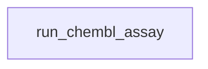

# Workflow run report: chembl_assay

- **workflow_run_id:** `f8c603ea-21ae-58fa-a984-bfcaee19f8e8`
- **status:** failed
- **extracted total:** 0
- **resumed:** False
- **fingerprint:** `924f2ece9cd3656c8ae6909eed933c54931a158d2158009bb9f347bca84abd1c`
- **duration_seconds:** 38.8401612000016

## Steps

| Step | Pipeline | Status | Extracted | Silver | Gold | Report |
|------|----------|--------|----------:|-------:|-----:|--------|
| run_chembl_assay | chembl_assay | failed | 0 | 0 | 0 | `…` |
  - report: `D:\github\BioactivityDataAcquisition\data\wf1120\01\reports\pipeline\chembl_assay\5d97cd96-4ee8-57ce-baae-3563c3dd5608\pipeline-run-report.json`

## Plan / DAG

- `run_chembl_assay` (pipeline) depends_on: —

## Totals

- planned: 1
- succeeded: 0
- failed: 1
- skipped: 0
- records_extracted_sum: **0**
- records_silver_sum: **0**
- records_gold_sum: **0**
