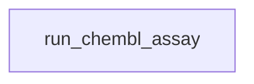

# Workflow run report: chembl_assay

- **workflow_run_id:** `8caa48d0-d6ad-5921-b49c-effec58c1b1e`
- **status:** success
- **extracted total:** 1000
- **resumed:** False
- **fingerprint:** `924f2ece9cd3656c8ae6909eed933c54931a158d2158009bb9f347bca84abd1c`
- **duration_seconds:** 68.5408626999997

## Steps

| Step | Pipeline | Status | Extracted | Silver | Gold | Report |
|------|----------|--------|----------:|-------:|-----:|--------|
| run_chembl_assay | chembl_assay | success | 1000 | 1000 | 983 | `…` |
  - report: `D:\github\BioactivityDataAcquisition\data\wf1120\02\reports\pipeline\chembl_assay\e4789b03-5ded-5aa7-8770-3b7c7355bb11\pipeline-run-report.json`
  - top reasons: column_filter_mismatch:bao_format=15, column_filter_mismatch:assay_test_type=2

## Plan / DAG

- `run_chembl_assay` (pipeline) depends_on: —

## Totals

- planned: 1
- succeeded: 1
- failed: 0
- skipped: 0
- records_extracted_sum: **1000**
- records_silver_sum: **1000**
- records_gold_sum: **983**

## Reasons rollup

- `column_filter_mismatch:bao_format` (excluded_by_contract): 15
- `column_filter_mismatch:assay_test_type` (excluded_by_contract): 2
