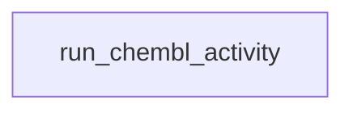

# Workflow run report: chembl_activity

- **workflow_run_id:** `fefad8ca-d1ba-5488-b777-39d641b33359`
- **status:** success
- **extracted total:** 1000
- **resumed:** False
- **fingerprint:** `fbd7345193d1a7cd8b4f04942ffa01a1f94ba8bca6d52ecb7d7a704af597dc34`
- **duration_seconds:** 76.9745455999946

## Steps

| Step | Pipeline | Status | Extracted | Silver | Gold | Report |
|------|----------|--------|----------:|-------:|-----:|--------|
| run_chembl_activity | chembl_activity | success | 1000 | 924 | 910 | `…` |
  - report: `D:\github\BioactivityDataAcquisition\data\wf1120\03\reports\pipeline\chembl_activity\f9ee04d2-965c-5c07-9c39-5a23ad0e6b82\pipeline-run-report.json`
  - top reasons: required_field_missing=76, range_filter_mismatch:pchembl_value=14

## Plan / DAG

- `run_chembl_activity` (pipeline) depends_on: —

## Totals

- planned: 1
- succeeded: 1
- failed: 0
- skipped: 0
- records_extracted_sum: **1000**
- records_silver_sum: **924**
- records_gold_sum: **910**

## Reasons rollup

- `required_field_missing` (filtered_out): 76
- `range_filter_mismatch:pchembl_value` (excluded_by_contract): 14
