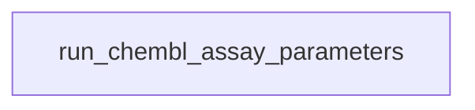

# Workflow run report: chembl_assay_parameters

- **workflow_run_id:** `bee6e25d-6a00-50ec-a4aa-32f2933cb4dc`
- **status:** success
- **extracted total:** 1000
- **resumed:** False
- **fingerprint:** `778f3242b0cc33d7d74115e54d5d6243666beb648e5738698244e919b96bcecf`
- **duration_seconds:** 207.3355484000058

## Steps

| Step | Pipeline | Status | Extracted | Silver | Gold | Report |
|------|----------|--------|----------:|-------:|-----:|--------|
| run_chembl_assay_parameters | chembl_assay_parameters | success | 1000 | 1000 | 1000 | `…` |
  - report: `D:\github\BioactivityDataAcquisition\data\wf1120\04\reports\pipeline\chembl_assay_parameters\49e3e40f-ad71-5c3c-b25c-15e8204f74ad\pipeline-run-report.json`

## Plan / DAG

- `run_chembl_assay_parameters` (pipeline) depends_on: —

## Totals

- planned: 1
- succeeded: 1
- failed: 0
- skipped: 0
- records_extracted_sum: **1000**
- records_silver_sum: **1000**
- records_gold_sum: **1000**
