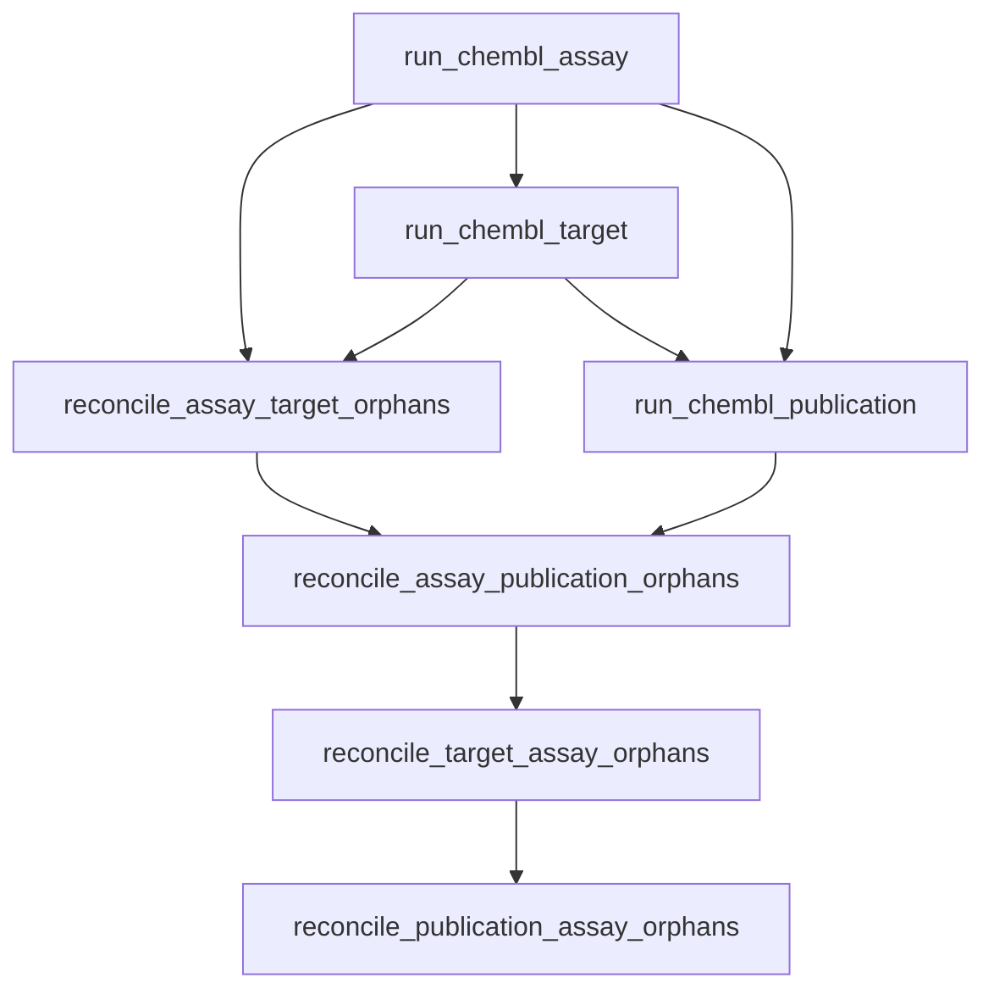

# Workflow run report: chembl_baseline

- **workflow_run_id:** `2b028c59-db6a-5ff3-afc4-6d17c60706b6`
- **status:** failed
- **extracted total:** 0
- **resumed:** False
- **fingerprint:** `a3394a88323fb8bbd9241ade1e9f61aa715f3b33e9655d6d66a3e6be66a11031`
- **duration_seconds:** 99.12098990000959

## Steps

| Step | Pipeline | Status | Extracted | Silver | Gold | Report |
|------|----------|--------|----------:|-------:|-----:|--------|
| run_chembl_assay | chembl_assay | failed | 0 | 0 | 0 | `…` |
  - report: `D:\github\BioactivityDataAcquisition\data\wf1120\05\reports\pipeline\chembl_assay\7bd7fe14-8d2c-54b5-abdf-e662953a9f26\pipeline-run-report.json`
| run_chembl_target | chembl_target | skipped | 0 | — | — | — |
| reconcile_assay_target_orphans | — | skipped | 0 | — | — | — |
| run_chembl_publication | chembl_publication | skipped | 0 | — | — | — |
| reconcile_assay_publication_orphans | — | skipped | 0 | — | — | — |
| reconcile_target_assay_orphans | — | skipped | 0 | — | — | — |
| reconcile_publication_assay_orphans | — | skipped | 0 | — | — | — |

## Plan / DAG

- `run_chembl_assay` (pipeline) depends_on: —
- `run_chembl_target` (pipeline) depends_on: `run_chembl_assay`
- `reconcile_assay_target_orphans` (transform) depends_on: `run_chembl_assay`, `run_chembl_target`
- `run_chembl_publication` (pipeline) depends_on: `run_chembl_target`, `run_chembl_assay`
- `reconcile_assay_publication_orphans` (transform) depends_on: `reconcile_assay_target_orphans`, `run_chembl_publication`
- `reconcile_target_assay_orphans` (transform) depends_on: `reconcile_assay_publication_orphans`
- `reconcile_publication_assay_orphans` (transform) depends_on: `reconcile_target_assay_orphans`

## Totals

- planned: 7
- succeeded: 0
- failed: 1
- skipped: 6
- records_extracted_sum: **0**
- records_silver_sum: **0**
- records_gold_sum: **0**
