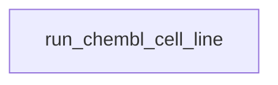

# Workflow run report: chembl_cell_line

- **workflow_run_id:** `fafcf9ec-507d-5284-93e0-536f677f9f85`
- **status:** failed
- **extracted total:** 0
- **resumed:** False
- **fingerprint:** `1a7cb4186eefc0bcdd78e5336fb487a34f194bfa5a7a816f2f9d9cfe444e9a86`
- **duration_seconds:** 37.236198800004786

## Steps

| Step | Pipeline | Status | Extracted | Silver | Gold | Report |
|------|----------|--------|----------:|-------:|-----:|--------|
| run_chembl_cell_line | chembl_cell_line | failed | 0 | 0 | 0 | `…` |
  - report: `D:\github\BioactivityDataAcquisition\data\wf1120\06\reports\pipeline\chembl_cell_line\14713067-7d42-5f2c-a0bd-08ab20d0a003\pipeline-run-report.json`

## Plan / DAG

- `run_chembl_cell_line` (pipeline) depends_on: —

## Totals

- planned: 1
- succeeded: 0
- failed: 1
- skipped: 0
- records_extracted_sum: **0**
- records_silver_sum: **0**
- records_gold_sum: **0**
