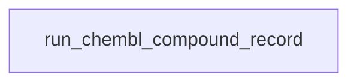

# Workflow run report: chembl_compound_record

- **workflow_run_id:** `46a3891a-ece5-5a84-9247-2b944c3a829d`
- **status:** success
- **extracted total:** 1000
- **resumed:** False
- **fingerprint:** `652e29525a78ef1798016cd45b2fa3c0c0e9af948e99745b31c7ecf650eaa004`
- **duration_seconds:** 142.6897450999968

## Steps

| Step | Pipeline | Status | Extracted | Silver | Gold | Report |
|------|----------|--------|----------:|-------:|-----:|--------|
| run_chembl_compound_record | chembl_compound_record | success | 1000 | 1000 | 1000 | `…` |
  - report: `D:\github\BioactivityDataAcquisition\data\wf1120\07\reports\pipeline\chembl_compound_record\ef04189c-3aca-563b-a7b9-203cf66f8e0b\pipeline-run-report.json`

## Plan / DAG

- `run_chembl_compound_record` (pipeline) depends_on: —

## Totals

- planned: 1
- succeeded: 1
- failed: 0
- skipped: 0
- records_extracted_sum: **1000**
- records_silver_sum: **1000**
- records_gold_sum: **1000**
