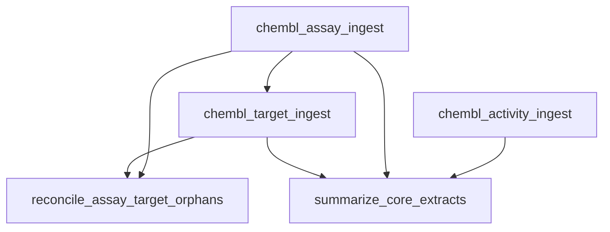

# Workflow run report: chembl_core

- **workflow_run_id:** `5be49576-4861-5377-ab81-6f2ee6db429e`
- **status:** failed
- **extracted total:** 2020
- **resumed:** False
- **fingerprint:** `edb69cc36aee9b02fe49694bae48b3da977f42644c0c06f859d3f5e86ebe69b9`
- **duration_seconds:** 251.69985770000494

## Steps

| Step | Pipeline | Status | Extracted | Silver | Gold | Report |
|------|----------|--------|----------:|-------:|-----:|--------|
| chembl_activity_ingest | chembl_activity | success | 1000 | 924 | 910 | `…` |
  - report: `D:\github\BioactivityDataAcquisition\data\wf1120\08\reports\pipeline\chembl_activity\c34159c1-376a-5144-b1b3-f2728384b714\pipeline-run-report.json`
  - top reasons: required_field_missing=76, range_filter_mismatch:pchembl_value=14
| chembl_assay_ingest | chembl_assay | success | 1000 | 1000 | 983 | `…` |
  - report: `D:\github\BioactivityDataAcquisition\data\wf1120\08\reports\pipeline\chembl_assay\c0bab6ad-604f-5ac4-85fb-795c80af2f49\pipeline-run-report.json`
  - top reasons: column_filter_mismatch:bao_format=15, column_filter_mismatch:assay_test_type=2
| chembl_target_ingest | chembl_target | failed | 20 | 0 | 0 | `…` |
  - report: `D:\github\BioactivityDataAcquisition\data\wf1120\08\reports\pipeline\chembl_target\d63e7efe-e60e-5616-b44d-bc401b17150c\pipeline-run-report.json`
| reconcile_assay_target_orphans | — | skipped | 0 | — | — | — |
| summarize_core_extracts | — | skipped | 0 | — | — | — |

## Plan / DAG

- `chembl_activity_ingest` (pipeline) depends_on: —
- `chembl_assay_ingest` (pipeline) depends_on: —
- `chembl_target_ingest` (pipeline) depends_on: `chembl_assay_ingest`
- `reconcile_assay_target_orphans` (transform) depends_on: `chembl_assay_ingest`, `chembl_target_ingest`
- `summarize_core_extracts` (transform) depends_on: `chembl_activity_ingest`, `chembl_assay_ingest`, `chembl_target_ingest`

## Totals

- planned: 5
- succeeded: 2
- failed: 1
- skipped: 2
- records_extracted_sum: **2020**
- records_silver_sum: **1924**
- records_gold_sum: **1893**

## Reasons rollup

- `required_field_missing` (filtered_out): 76
- `column_filter_mismatch:bao_format` (excluded_by_contract): 15
- `range_filter_mismatch:pchembl_value` (excluded_by_contract): 14
- `column_filter_mismatch:assay_test_type` (excluded_by_contract): 2
