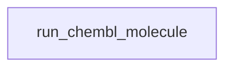

# Workflow run report: chembl_molecule

- **workflow_run_id:** `ba4e3fc2-3c82-5c65-98b7-26290c0a8ffb`
- **status:** success
- **extracted total:** 1000
- **resumed:** False
- **fingerprint:** `e21fa1a9481efa90172eb691bd127141cc372ae63f6da9624db0b68bd211dad6`
- **duration_seconds:** 56.71496990000014

## Steps

| Step | Pipeline | Status | Extracted | Silver | Gold | Report |
|------|----------|--------|----------:|-------:|-----:|--------|
| run_chembl_molecule | chembl_molecule | success | 1000 | 1000 | 1000 | `…` |
  - report: `D:\github\BioactivityDataAcquisition\data\wf1120\09\reports\pipeline\chembl_molecule\613bcae8-34f4-5ae3-a560-27eefcfd9d65\pipeline-run-report.json`

## Plan / DAG

- `run_chembl_molecule` (pipeline) depends_on: —

## Totals

- planned: 1
- succeeded: 1
- failed: 0
- skipped: 0
- records_extracted_sum: **1000**
- records_silver_sum: **1000**
- records_gold_sum: **1000**
