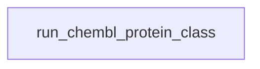

# Workflow run report: chembl_protein_class

- **workflow_run_id:** `a573be01-a6ab-5b86-9d72-46b9f0b13889`
- **status:** success
- **extracted total:** 905
- **resumed:** False
- **fingerprint:** `e9341eb4afdc7dfe07f28d654ab22f9956fb3833f3fb93fa917a1952d1d57c51`
- **duration_seconds:** 46.92855209999834

## Steps

| Step | Pipeline | Status | Extracted | Silver | Gold | Report |
|------|----------|--------|----------:|-------:|-----:|--------|
| run_chembl_protein_class | chembl_protein_class | success | 905 | 904 | 904 | `…` |
  - report: `D:\github\BioactivityDataAcquisition\data\wf1120\10\reports\pipeline\chembl_protein_class\0151d488-d942-51ba-8f06-d9dfe652382f\pipeline-run-report.json`
  - top reasons: FILTERED_OUT_SILVER:protein_class_id=1

## Plan / DAG

- `run_chembl_protein_class` (pipeline) depends_on: —

## Totals

- planned: 1
- succeeded: 1
- failed: 0
- skipped: 0
- records_extracted_sum: **905**
- records_silver_sum: **904**
- records_gold_sum: **904**

## Reasons rollup

- `FILTERED_OUT_SILVER:protein_class_id` (filtered_out): 1
