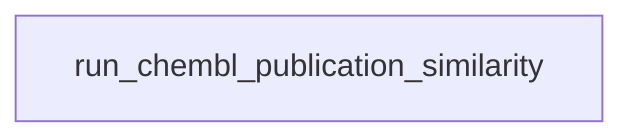

# Workflow run report: chembl_publication_similarity

- **workflow_run_id:** `bc4ead33-d7b1-5ab1-a7ad-c9d26c891b1d`
- **status:** success
- **extracted total:** 1000
- **resumed:** False
- **fingerprint:** `038e84924b5fdc4cce79839b1dcc11c2afa334e903c148188c1122fef8603099`
- **duration_seconds:** 111.30949790000159

## Steps

| Step | Pipeline | Status | Extracted | Silver | Gold | Report |
|------|----------|--------|----------:|-------:|-----:|--------|
| run_chembl_publication_similarity | chembl_publication_similarity | success | 1000 | 1000 | 1000 | `…` |
  - report: `D:\github\BioactivityDataAcquisition\data\wf1120\11\reports\pipeline\chembl_publication_similarity\df8f3565-f476-51ae-86ed-a7f5d32a2aea\pipeline-run-report.json`

## Plan / DAG

- `run_chembl_publication_similarity` (pipeline) depends_on: —

## Totals

- planned: 1
- succeeded: 1
- failed: 0
- skipped: 0
- records_extracted_sum: **1000**
- records_silver_sum: **1000**
- records_gold_sum: **1000**
