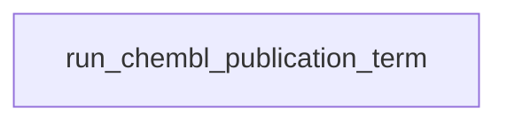

# Workflow run report: chembl_publication_term

- **workflow_run_id:** `fe1e41a9-a709-5069-8b8e-c7a9d404156e`
- **status:** failed
- **extracted total:** 0
- **resumed:** False
- **fingerprint:** `de9223ce68e4e65c827e661864075fa61bf44d7ecd02f94cde788890a708f346`
- **duration_seconds:** 591.0149369999999

## Steps

| Step | Pipeline | Status | Extracted | Silver | Gold | Report |
|------|----------|--------|----------:|-------:|-----:|--------|
| run_chembl_publication_term | chembl_publication_term | failed | 0 | 0 | 0 | `…` |
  - report: `D:\github\BioactivityDataAcquisition\data\wf1120\12\reports\pipeline\chembl_publication_term\0cad7668-0e53-5f62-bb23-05d0187c1333\pipeline-run-report.json`

## Plan / DAG

- `run_chembl_publication_term` (pipeline) depends_on: —

## Totals

- planned: 1
- succeeded: 0
- failed: 1
- skipped: 0
- records_extracted_sum: **0**
- records_silver_sum: **0**
- records_gold_sum: **0**
