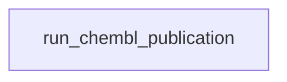

# Workflow run report: chembl_publication

- **workflow_run_id:** `56091b3e-4e91-51b4-8519-6209efec0ab8`
- **status:** failed
- **extracted total:** 0
- **resumed:** False
- **fingerprint:** `fcbd801c21db29753ed0fdea1b7b01119b5871d720912434368307155e65b010`
- **duration_seconds:** 34.905846399997245

## Steps

| Step | Pipeline | Status | Extracted | Silver | Gold | Report |
|------|----------|--------|----------:|-------:|-----:|--------|
| run_chembl_publication | chembl_publication | failed | 0 | 0 | 0 | `…` |
  - report: `D:\github\BioactivityDataAcquisition\data\wf1120\13\reports\pipeline\chembl_publication\63977221-3f9f-56d2-9b50-c5c7a1378304\pipeline-run-report.json`

## Plan / DAG

- `run_chembl_publication` (pipeline) depends_on: —

## Totals

- planned: 1
- succeeded: 0
- failed: 1
- skipped: 0
- records_extracted_sum: **0**
- records_silver_sum: **0**
- records_gold_sum: **0**
