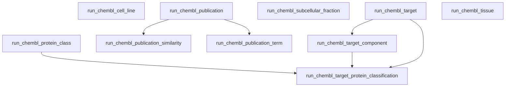

# Workflow run report: chembl_reference_pack

- **workflow_run_id:** `6fb38224-594e-5802-aa72-7137e03a1eac`
- **status:** failed
- **extracted total:** 0
- **resumed:** False
- **fingerprint:** `58bbe937c8f00bafb967c140030a58f6a00f5516fc048b8d0cff81b980d1d3d3`
- **duration_seconds:** 219.48221250000643

## Steps

| Step | Pipeline | Status | Extracted | Silver | Gold | Report |
|------|----------|--------|----------:|-------:|-----:|--------|
| run_chembl_cell_line | chembl_cell_line | failed | 0 | 0 | 0 | `…` |
  - report: `D:\github\BioactivityDataAcquisition\data\wf1120\14\reports\pipeline\chembl_cell_line\9ff8b8a2-0314-57a3-9427-082ef7874667\pipeline-run-report.json`
| run_chembl_protein_class | chembl_protein_class | failed | 0 | 0 | 0 | `…` |
  - report: `D:\github\BioactivityDataAcquisition\data\wf1120\14\reports\pipeline\chembl_protein_class\ae39d4da-0118-51f7-b96a-da23eaf4931a\pipeline-run-report.json`
| run_chembl_publication | chembl_publication | failed | 0 | 0 | 0 | `…` |
  - report: `D:\github\BioactivityDataAcquisition\data\wf1120\14\reports\pipeline\chembl_publication\5441ea0d-01d5-5f77-aa3c-9ac321f98abe\pipeline-run-report.json`
| run_chembl_subcellular_fraction | chembl_subcellular_fraction | failed | 0 | 0 | 0 | `…` |
  - report: `D:\github\BioactivityDataAcquisition\data\wf1120\14\reports\pipeline\chembl_subcellular_fraction\2dc51f34-ba3e-5513-8506-e85d78e95de8\pipeline-run-report.json`
| run_chembl_target | chembl_target | failed | 0 | 0 | 0 | `…` |
  - report: `D:\github\BioactivityDataAcquisition\data\wf1120\14\reports\pipeline\chembl_target\80bbca48-6d27-54e0-9969-359575d4fc16\pipeline-run-report.json`
| run_chembl_tissue | chembl_tissue | failed | 0 | 0 | 0 | `…` |
  - report: `D:\github\BioactivityDataAcquisition\data\wf1120\14\reports\pipeline\chembl_tissue\b5159905-b580-5538-a482-f1d391df499f\pipeline-run-report.json`
| run_chembl_publication_similarity | chembl_publication_similarity | skipped | 0 | — | — | — |
| run_chembl_publication_term | chembl_publication_term | skipped | 0 | — | — | — |
| run_chembl_target_component | chembl_target_component | skipped | 0 | — | — | — |
| run_chembl_target_protein_classification | chembl_target_protein_classification | skipped | 0 | — | — | — |

## Plan / DAG

- `run_chembl_cell_line` (pipeline) depends_on: —
- `run_chembl_protein_class` (pipeline) depends_on: —
- `run_chembl_publication` (pipeline) depends_on: —
- `run_chembl_subcellular_fraction` (pipeline) depends_on: —
- `run_chembl_target` (pipeline) depends_on: —
- `run_chembl_tissue` (pipeline) depends_on: —
- `run_chembl_publication_similarity` (pipeline) depends_on: `run_chembl_publication`
- `run_chembl_publication_term` (pipeline) depends_on: `run_chembl_publication`
- `run_chembl_target_component` (pipeline) depends_on: `run_chembl_target`
- `run_chembl_target_protein_classification` (pipeline) depends_on: `run_chembl_target`, `run_chembl_target_component`, `run_chembl_protein_class`

## Totals

- planned: 10
- succeeded: 0
- failed: 6
- skipped: 4
- records_extracted_sum: **0**
- records_silver_sum: **0**
- records_gold_sum: **0**
