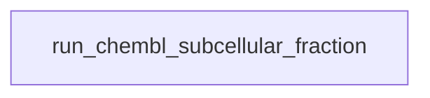

# Workflow run report: chembl_subcellular_fraction

- **workflow_run_id:** `ce2dfbf6-cd35-5482-acd6-b42b25177d24`
- **status:** failed
- **extracted total:** 0
- **resumed:** False
- **fingerprint:** `6bcb71b4f85ad26d55be741295aa589f56b4c8ec11e3931ffd34db9bb6068def`
- **duration_seconds:** 46.239907000010135

## Steps

| Step | Pipeline | Status | Extracted | Silver | Gold | Report |
|------|----------|--------|----------:|-------:|-----:|--------|
| run_chembl_subcellular_fraction | chembl_subcellular_fraction | failed | 0 | 0 | 0 | `…` |
  - report: `D:\github\BioactivityDataAcquisition\data\wf1120\15\reports\pipeline\chembl_subcellular_fraction\23eae742-4466-592d-88ce-e3ca9cb60498\pipeline-run-report.json`

## Plan / DAG

- `run_chembl_subcellular_fraction` (pipeline) depends_on: —

## Totals

- planned: 1
- succeeded: 0
- failed: 1
- skipped: 0
- records_extracted_sum: **0**
- records_silver_sum: **0**
- records_gold_sum: **0**
