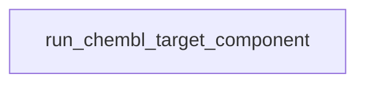

# Workflow run report: chembl_target_component

- **workflow_run_id:** `b7f5cdc1-8f9d-542f-b750-4c9219119980`
- **status:** failed
- **extracted total:** 0
- **resumed:** False
- **fingerprint:** `a1332911706b133dcca7c6aa3d227d4b8f2e0d97014efeb1d83f291d3a838812`
- **duration_seconds:** 25.8591035999998

## Steps

| Step | Pipeline | Status | Extracted | Silver | Gold | Report |
|------|----------|--------|----------:|-------:|-----:|--------|
| run_chembl_target_component | chembl_target_component | failed | 0 | 0 | 0 | `…` |
  - report: `D:\github\BioactivityDataAcquisition\data\wf1120\16\reports\pipeline\chembl_target_component\288ccab7-aa13-5205-a1db-c23ed79a6e22\pipeline-run-report.json`

## Plan / DAG

- `run_chembl_target_component` (pipeline) depends_on: —

## Totals

- planned: 1
- succeeded: 0
- failed: 1
- skipped: 0
- records_extracted_sum: **0**
- records_silver_sum: **0**
- records_gold_sum: **0**
