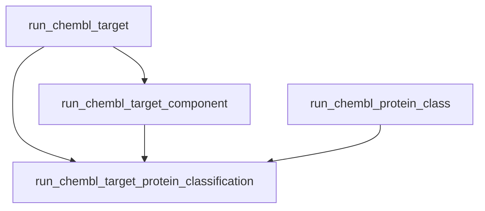

# Workflow run report: chembl_target_protein_classification

- **workflow_run_id:** `e7d65d91-dbbf-5b05-a5b4-f972fd1fd589`
- **status:** failed
- **extracted total:** 1500
- **resumed:** False
- **fingerprint:** `7fab9506364985f072a37361e3b498d7e5d22a5749991e6ac7c68f1a2ae3e9f6`
- **duration_seconds:** 207.9628575000097

## Steps

| Step | Pipeline | Status | Extracted | Silver | Gold | Report |
|------|----------|--------|----------:|-------:|-----:|--------|
| run_chembl_protein_class | chembl_protein_class | failed | 500 | 499 | 499 | `…` |
  - report: `D:\github\BioactivityDataAcquisition\data\wf1120\17\reports\pipeline\chembl_protein_class\6e797f4a-3b88-5cb1-a60e-a3a8387173bb\pipeline-run-report.json`
  - top reasons: FILTERED_OUT_SILVER:protein_class_id=1
| run_chembl_target | chembl_target | success | 1000 | 1000 | 922 | `…` |
  - report: `D:\github\BioactivityDataAcquisition\data\wf1120\17\reports\pipeline\chembl_target\6352bbe3-489a-56fe-bee5-5bf0f4cf0a1e\pipeline-run-report.json`
  - top reasons: column_filter_mismatch:organism_class=78
| run_chembl_target_component | chembl_target_component | failed | 0 | 0 | 0 | `…` |
  - report: `D:\github\BioactivityDataAcquisition\data\wf1120\17\reports\pipeline\chembl_target_component\68e41977-af66-59d1-9829-54301c1791be\pipeline-run-report.json`
| run_chembl_target_protein_classification | chembl_target_protein_classification | skipped | 0 | — | — | — |

## Plan / DAG

- `run_chembl_protein_class` (pipeline) depends_on: —
- `run_chembl_target` (pipeline) depends_on: —
- `run_chembl_target_component` (pipeline) depends_on: `run_chembl_target`
- `run_chembl_target_protein_classification` (pipeline) depends_on: `run_chembl_target`, `run_chembl_target_component`, `run_chembl_protein_class`

## Totals

- planned: 4
- succeeded: 1
- failed: 2
- skipped: 1
- records_extracted_sum: **1500**
- records_silver_sum: **1499**
- records_gold_sum: **1421**

## Reasons rollup

- `column_filter_mismatch:organism_class` (excluded_by_contract): 78
- `FILTERED_OUT_SILVER:protein_class_id` (filtered_out): 1
