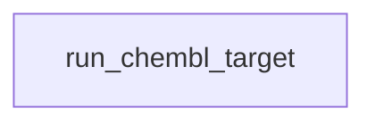

# Workflow run report: chembl_target

- **workflow_run_id:** `79cebb92-2394-5c52-8b72-2ebb11252631`
- **status:** failed
- **extracted total:** 0
- **resumed:** False
- **fingerprint:** `aa68611f468bfd27356dbbc4defbfdf0057944df90b04166c051b53665da28fe`
- **duration_seconds:** 91.01418040000135

## Steps

| Step | Pipeline | Status | Extracted | Silver | Gold | Report |
|------|----------|--------|----------:|-------:|-----:|--------|
| run_chembl_target | chembl_target | failed | 0 | 0 | 0 | `…` |
  - report: `D:\github\BioactivityDataAcquisition\data\wf1120\18\reports\pipeline\chembl_target\3f23aedd-9385-5a47-a09e-56f81599ea76\pipeline-run-report.json`

## Plan / DAG

- `run_chembl_target` (pipeline) depends_on: —

## Totals

- planned: 1
- succeeded: 0
- failed: 1
- skipped: 0
- records_extracted_sum: **0**
- records_silver_sum: **0**
- records_gold_sum: **0**
