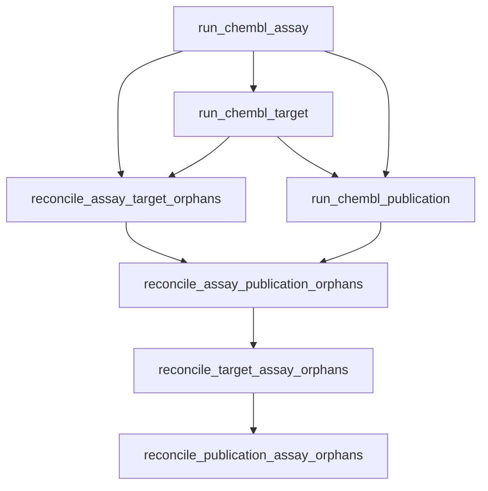

# Workflow run report: chembl_baseline

- **workflow_run_id:** `cbbad724-4f10-58bc-8044-fc627377c052`
- **status:** success
- **extracted total:** 3000
- **resumed:** False
- **fingerprint:** `a54e4fbcc41f066e18b6814a5e43df1aaf1e3b31c37f5bbcb8ea859530cc7751`
- **duration_seconds:** 230.9878658000016

## Steps

| Step | Pipeline | Status | Extracted | Silver | Gold | Report |
|------|----------|--------|----------:|-------:|-----:|--------|
| run_chembl_assay | chembl_assay | success | 1000 | 1000 | 983 | `…` |
  - report: `D:\github\BioactivityDataAcquisition\data\workflow-reconciliation\repair-20261111\chembl_baseline\reports\run-reports\pipeline\chembl_assay\078bc2b4-1f48-5c1b-8295-1de7d716e2b7\pipeline-run-report.json`
  - top reasons: column_filter_mismatch:bao_format=15, column_filter_mismatch:assay_test_type=2
| run_chembl_target | chembl_target | success | 1000 | 1000 | 922 | `…` |
  - report: `D:\github\BioactivityDataAcquisition\data\workflow-reconciliation\repair-20261111\chembl_baseline\reports\run-reports\pipeline\chembl_target\a67c8b67-a6c5-5125-8649-f2008314152b\pipeline-run-report.json`
  - top reasons: column_filter_mismatch:organism_class=78
| reconcile_assay_target_orphans | — | success | 0 | — | — | — |
| run_chembl_publication | chembl_publication | success | 1000 | 1000 | 1000 | `…` |
  - report: `D:\github\BioactivityDataAcquisition\data\workflow-reconciliation\repair-20261111\chembl_baseline\reports\run-reports\pipeline\chembl_publication\7e3cd3fe-8459-5351-a9f6-b2979d54cd15\pipeline-run-report.json`
| reconcile_assay_publication_orphans | — | success | 0 | — | — | — |
| reconcile_target_assay_orphans | — | success | 0 | — | — | — |
| reconcile_publication_assay_orphans | — | success | 0 | — | — | — |

## Plan / DAG

- `run_chembl_assay` (pipeline) depends_on: —
- `run_chembl_target` (pipeline) depends_on: `run_chembl_assay`
- `reconcile_assay_target_orphans` (transform) depends_on: `run_chembl_assay`, `run_chembl_target`
- `run_chembl_publication` (pipeline) depends_on: `run_chembl_target`, `run_chembl_assay`
- `reconcile_assay_publication_orphans` (transform) depends_on: `reconcile_assay_target_orphans`, `run_chembl_publication`
- `reconcile_target_assay_orphans` (transform) depends_on: `reconcile_assay_publication_orphans`
- `reconcile_publication_assay_orphans` (transform) depends_on: `reconcile_target_assay_orphans`

## Totals

- planned: 7
- succeeded: 7
- failed: 0
- skipped: 0
- records_extracted_sum: **3000**
- records_silver_sum: **3000**
- records_gold_sum: **2905**

## Reasons rollup

- `column_filter_mismatch:organism_class` (excluded_by_contract): 78
- `column_filter_mismatch:bao_format` (excluded_by_contract): 15
- `column_filter_mismatch:assay_test_type` (excluded_by_contract): 2
