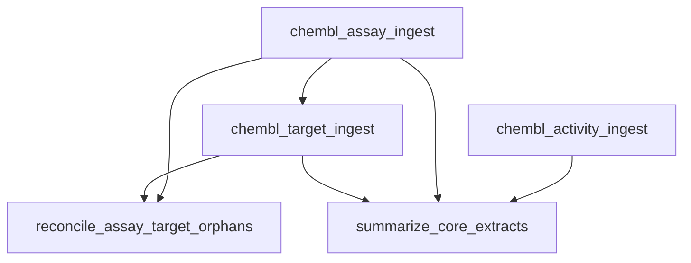

# Workflow run report: chembl_core

- **workflow_run_id:** `e4a9008b-a49f-5f06-851d-27d296237998`
- **status:** success
- **extracted total:** 3000
- **resumed:** False
- **fingerprint:** `9012d559d721da7d2e6f644fb58b5fded62e2c6020d4f03e24fd13b976151d27`
- **duration_seconds:** 118.7924497999993

## Steps

| Step | Pipeline | Status | Extracted | Silver | Gold | Report |
|------|----------|--------|----------:|-------:|-----:|--------|
| chembl_activity_ingest | chembl_activity | success | 1000 | 924 | 910 | `…` |
  - report: `D:\github\BioactivityDataAcquisition\data\workflow-reconciliation\repair-20261111\chembl_core\reports\run-reports\pipeline\chembl_activity\75289a8a-402b-54ae-a27b-33a51ecac194\pipeline-run-report.json`
  - top reasons: required_field_missing=76, range_filter_mismatch:pchembl_value=14
| chembl_assay_ingest | chembl_assay | success | 1000 | 1000 | 983 | `…` |
  - report: `D:\github\BioactivityDataAcquisition\data\workflow-reconciliation\repair-20261111\chembl_core\reports\run-reports\pipeline\chembl_assay\24231b65-d913-5a32-bbc0-65fbfef01716\pipeline-run-report.json`
  - top reasons: column_filter_mismatch:bao_format=15, column_filter_mismatch:assay_test_type=2
| chembl_target_ingest | chembl_target | success | 1000 | 1000 | 922 | `…` |
  - report: `D:\github\BioactivityDataAcquisition\data\workflow-reconciliation\repair-20261111\chembl_core\reports\run-reports\pipeline\chembl_target\7771872e-9c87-51a5-9ae9-6c07ab05eb07\pipeline-run-report.json`
  - top reasons: column_filter_mismatch:organism_class=78
| reconcile_assay_target_orphans | — | success | 0 | — | — | — |
| summarize_core_extracts | — | success | 0 | — | — | — |

## Plan / DAG

- `chembl_activity_ingest` (pipeline) depends_on: —
- `chembl_assay_ingest` (pipeline) depends_on: —
- `chembl_target_ingest` (pipeline) depends_on: `chembl_assay_ingest`
- `reconcile_assay_target_orphans` (transform) depends_on: `chembl_assay_ingest`, `chembl_target_ingest`
- `summarize_core_extracts` (transform) depends_on: `chembl_activity_ingest`, `chembl_assay_ingest`, `chembl_target_ingest`

## Totals

- planned: 5
- succeeded: 5
- failed: 0
- skipped: 0
- records_extracted_sum: **3000**
- records_silver_sum: **2924**
- records_gold_sum: **2815**

## Reasons rollup

- `column_filter_mismatch:organism_class` (excluded_by_contract): 78
- `required_field_missing` (filtered_out): 76
- `column_filter_mismatch:bao_format` (excluded_by_contract): 15
- `range_filter_mismatch:pchembl_value` (excluded_by_contract): 14
- `column_filter_mismatch:assay_test_type` (excluded_by_contract): 2
