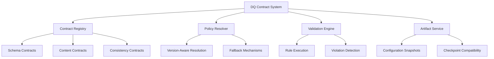

______________________________________________________________________

Version: 1.1.0
Status: Accepted
Class: published
Owner: BioETL Team
Reviewers:

- BioETL Team
  Last verified: '2026-10-21'

______________________________________________________________________

# ADR-045: Data Quality Contract System

**Date:** 2026-03-26
**Status:** Accepted
**Decision makers:** @BioETL-Team

## Context

The BioETL pipeline required a comprehensive data quality framework to ensure:

- Consistent data validation across multiple data providers (ChEMBL, PubChem, etc.)
- Auditability and provenance tracking for compliance requirements
- Configurable quality thresholds and policies
- Backward compatibility during system evolution
- Governance and observability for data quality issues

Previously, data quality validation was inconsistent across the pipeline, with different providers implementing ad-hoc validation logic. This led to:

- Inconsistent data quality standards
- Difficult debugging and troubleshooting
- Lack of audit trail for quality issues
- Challenges in maintaining backward compatibility

## Decision

Implement a contract-based Data Quality (DQ) System with the following characteristics:

**Operationalization note (2026-05-14):** DQ rules that validate identifier
and title clusters bind to the canonical field names published in
`configs/field_registry/canonical_registry.json`.

### 1. Contract-Based Validation Architecture



### 2. Core Components

#### 2.1 DQ Contract Types

```python
# Core DQ Contract Types
class DQDisposition(StrEnum):
    """Canonical dispositions for DQ rule outcomes"""

    PASS = "pass"  # No violation detected
    WARN = "warn"  # Violation detected but not severe enough for action
    QUARANTINE = "quarantine"  # Isolate records for review
    SKIP = "skip"  # Skip processing this data
    FAIL = "fail"  # Hard failure - stop processing


class DQViolationKind(StrEnum):
    """Category of DQ violation"""

    SCHEMA_VIOLATION = "schema_violation"  # Structural validation
    THRESHOLD_BREACH = "threshold_breach"  # Quality threshold exceeded
    BUSINESS_RULE_VIOLATION = "business_rule_violation"  # Business rule violations
    CROSS_VALIDATION_MISMATCH = "cross_validation_mismatch"  # Cross-source validation
    ANOMALY_SIGNAL = "anomaly_signal"  # Statistical anomaly detection


class DQPolicyRef(NamedTuple):
    """Reference to specific DQ policy"""

    contract_id: str
    version: str
    severity: DQDisposition = DQDisposition.FAIL
```

#### 2.2 Contract Validation Layers

1. **Schema Validation**: Pandera-owned runtime validation for DataFrame
   contract enforcement. JSON/YAML contract artifacts are derived
   projection/catalog surfaces unless a specific runtime path explicitly
   documents otherwise. *(Status: Working fail-closed schema integration in production)*
1. **Content Validation**: Rule-based validation for data quality
1. **Consistency Validation**: Cross-source data consistency checks
1. **Provenance Validation**: Lineage and audit trail verification

The rule-level outcome channel is active.
`ContractAwareGoldValidator.validate_with_outcomes()` and
`ContractAwareSilverValidator.validate_with_outcomes()` return a
`DQOutcomeChannel`. The channel unpacks as `(is_valid, outcomes)` and
carries `AttributedDQViolation` values. Executable contract rules are loaded
from the bound `DQConfig` by `load_executable_contract_rules()`.
`DQPolicyResolver.resolve_disposition()` and `create_rule_outcome()` assign
dispositions; the resolver does not load a rule bundle from
`policy_ref.contract_ref`.

Without a policy resolver both methods keep the basic `validate()` validity
flag and an empty outcome list. With a resolver, an empty input yields a
valid empty channel. A missing schema in strict mode yields one
unattributable `schema.missing` outcome for non-empty input. Otherwise
Pandera failures and contract-rule violations become `DQRuleOutcome` values.
Record identity is separate from the rule outcome: `DQRecordIdentity` stores
the post-normalization `source_index` and an optional canonical
`record_key`. `affected_fields` is not a row selector. Schema-level errors
without a failure-case row index stay unattributable.

Gold `write_gold` consumes `validate_with_outcomes()` when the bound
`DQConfig` has an explicit outcome policy (at least one executable rule or a
disposition override). Attributable `QUARANTINE` business-rule violations,
and schema violations whose rule id has an explicit `QUARANTINE` override,
are accumulated synchronously and sent per record through
`write_quarantine_requests()` with `rule_id`, `contract_ref`, and
`config_path`. Each request carries a deterministic `entry_id` derived from
the batch id, source index, and rule ids; the quarantine adapter stores that
id in metadata and skips a later append of the same id. Schema violations
whose override is `PASS` or `WARN` stay fail-closed, the same as schema
violations without an explicit `QUARANTINE` override. `FAIL`, `SKIP`,
unattributable violations, and contracts without an explicit outcome policy
stay on batch-level fail-closed `validate()` and `SchemaViolationError`.
When the writer has a batch-metrics recorder, the flush increments
`bioetl_dq_records_quarantined_total` through that recorder. A domain-event
emitter wired on the writer publishes the companion quarantine events.
Silver production writes still call `validate()`.
`evaluate_dq_rules_for_record()` remains the transformer runtime path and
still applies quarantine, skip, fail, and warn dispositions before Gold.

#### 2.3 Policy Resolution Strategy

Gold and Silver runtime contract activation is fail-closed. The resolution chain
below applies to explicit DQ policy lookup and reporting/catalog contexts; it
MUST NOT silently activate a default/global Gold or Silver schema contract when
the requested runtime contract cannot be resolved.

```
Exact Match (contract_id + version)
    ↓
Latest Version of Contract
    ↓
Default Contract for Entity Type
    ↓
Global Fallback Policy (reporting/catalog contexts only)
```

#### 2.4 Configuration Runtime Artifacts

```yaml
# EffectiveConfigArtifact Example
effective_config:
  version: "1.0"
  timestamp: "2024-03-25T14:30:00Z"
  pipeline_name: "chembl_molecule_etl"
  dq_contracts:
    - contract_id: "molecule_schema_validation"
      version: "2.1"
      hash: "a1b2c3d4e5f67890"
      disposition: "fail"
  provenance:
    git_commit: "abc1234"
    config_files:
      - "configs/providers/chembl.yaml"
      - "configs/entities/chembl/molecule.yaml"
```

### 3. Phased Migration Support

```python
# Migration Phase Configuration
class MigrationPhaseConfig:
    phase_name: str
    start_version: str
    end_version: str | None
    backward_compatible: bool
    migration_strategy: Literal["immediate", "gradual", "optional"]
    fallback_behavior: Literal["warn", "error", "silent"]


# Version Comparison Logic
def version_compare(v1: str, v2: str) -> int:
    """Compare semantic versions (-1, 0, 1)"""
    # Implementation handles different version lengths
    # e.g., "1.2" vs "1.2.3" -> "1.2.0" vs "1.2.3"
```

## Implementation Details

### Integration Points

1. **Pipeline Initialization**: DQ contracts loaded and validated
1. **Data Ingestion**: Schema and content validation applied
1. **Transformation**: Consistency checks between sources
1. **Output**: Final DQ validation before persistence
1. **Observability**: DQ metrics and violations logged

### Configuration Example

```yaml
# configs/providers/chembl.yaml
dq_contracts:
  schema_validation:
    version: "2.1"
    disposition: "fail"
    rules:
      - type: "required_fields"
        fields: ["molecule_id", "smiles", "assay_type"]
      - type: "field_types"
        molecule_id: "string"
        smiles: "string"
        assay_type: "string"
        pchembl_value: "number"

  content_validation:
    version: "1.3"
    disposition: "warn"
    rules:
      - type: "range_check"
        field: "pchembl_value"
        min: 0
        max: 100
      - type: "pattern_match"
        field: "smiles"
        pattern: "^[A-Za-z0-9@+=\-\[\]()/.]+$"

  consistency_validation:
    version: "1.0"
    disposition: "quarantine"
    rules:
      - type: "cross_source"
        primary: "chembl"
        comparison: ["pubchem", "bindingdb"]
        fields: ["molecule_id", "smiles"]
        tolerance: 0.95
```

### Performance Considerations

1. **Caching**: DQ policy resolution results cached for performance
1. **Parallel Validation**: Independent validations run in parallel
1. **Lazy Loading**: DQ contracts loaded only when needed
1. **Incremental Validation**: Only changed data re-validated

## Consequences

### Positive ✅

1. **Consistent Quality Standards**: Uniform DQ validation across all providers
1. **Improved Debugging**: Clear audit trail for data quality issues
1. **Reproducible Runs**: Configuration artifacts enable exact reproduction
1. **Smooth Migrations**: Phased approach for breaking changes
1. **Enhanced Observability**: Comprehensive DQ metrics and logging
1. **Governance Compliance**: Formal contract system meets regulatory needs

### Negative ❌

1. **Increased Complexity**: More components to understand and maintain
1. **Performance Overhead**: Additional validation steps add processing time
1. **Learning Curve**: Team needs to learn new contract system concepts
1. **Configuration Management**: More configuration files to maintain
1. **Backward Compatibility**: Requires careful version management

## Alternatives Considered

### 1. Simple Validation Library

**Rejected because**: Lacked governance features, no contract system, limited observability

### 2. External DQ Service

**Rejected because**: Latency concerns, reliability issues, vendor lock-in risks

### 3. Provider-Specific Validation

**Rejected because**: Inconsistency across pipeline, maintenance burden, no unified standards

### 4. Rule Engine Approach

**Rejected because**: Overly complex for our needs, difficult to debug, poor performance

## Success Metrics

1. **DQ Issue Detection**: 95%+ of data quality issues caught before production
1. **Configuration Stability**: \<5% of pipeline runs affected by config changes
1. **Migration Success**: 100% backward compatibility during transition periods
1. **Performance Impact**: \<10% overhead on pipeline execution time
1. **Adoption Rate**: 100% of new pipelines use DQ contract system within 6 months

## Rollout

### Phase 1: Foundation (Completed)

- [x] Core DQ contract types and interfaces
- [x] Basic policy resolution logic
- [x] Configuration artifact framework
- [x] Unit tests for core components

### Phase 2: Integration (Completed)

- [x] Pipeline integration points
- [x] Provider-specific contract implementations
- [x] Observability and logging
- [x] Integration tests

### Phase 3: Adoption (In Progress)

- [ ] Migration of existing pipelines
- [ ] Documentation and training
- [ ] Performance optimization
- [ ] Monitoring and alerts

### Phase 4: Maturity (Planned)

- [ ] Advanced policy features
- [ ] Machine learning for anomaly detection
- [ ] Automated contract generation
- [ ] Contract versioning system

## References

- [ADR-002: Medallion Architecture](ADR-002-medallion-architecture.md)
- [ADR-017: Observability Architecture](ADR-017-observability-architecture.md)
- [DQ Contracts Reference](../../04-reference/contracts/dq-contracts.md)
- [Configuration Runtime Artifacts](../../04-reference/components/config-runtime-artifacts.md)

## Revision History

- **1.0** (2024-03-25): Initial draft
- **1.1** (2024-03-28): Added implementation details
- **1.2** (2024-04-01): Incorporated feedback from architecture review

## Compliance

| Control      | Requirement                                                                | Status | Evidence                             |
| ------------ | -------------------------------------------------------------------------- | ------ | ------------------------------------ |
| Format       | ADR MUST use standard metadata and normalized section headings             | `pass` | `ADR-045-dq-contract-system.md`      |
| Status       | ADR status MUST be explicit and consistent                                 | `pass` | `Accepted`                           |
| Supersession | Superseded or superseding ADRs SHOULD be linked explicitly when applicable | `n/a`  | `metadata block`                     |
| Verification | Implementation and validation expectations MUST be documented              | `pass` | `Verification / Acceptance Criteria` |
| References   | Related ADRs, docs, or artifacts SHOULD be linked                          | `pass` | `References`                         |

## Rollback

- Rollback MUST identify the last known-good behavior or artifact set.
- If the decision changes contracts, configuration, or storage semantics, rollback SHOULD include data and compatibility checks.
- Rollback triggers SHOULD be observable through tests, runtime signals, or regression symptoms.

## Verification

- Verify architecture, configuration, and documentation changes against the current codebase.
- Run the relevant tests, validators, or parity checks before considering the ADR fully adopted.
- Confirm downstream docs and contracts reflect the same decision boundaries.

## Acceptance Criteria

- [ ] The decision is documented with current status, date, and owner metadata.
- [ ] The implementation path or adoption boundary is testable and linked from the ADR.
- [ ] Supersession or migration impact is documented when the decision changes an earlier posture.
- [ ] Related docs, contracts, and operational guidance are aligned with this ADR.
