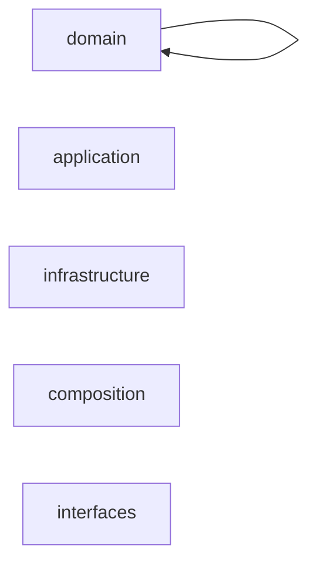

# Module Dependency Map (Auto-Generated)

> Generated by `scripts/engineering/qa/generate_architecture_dependency_map.py`. Do not edit manually.
> This artifact is a layer-policy and coarse topology snapshot only. It is not a hotspot, duplication, size, or churn scorecard.

## Summary

- Scanned modules: `0`
- Internal import edges (raw): `0`
- Aggregated layer edges: `0`
- Layer policy violations: `0`
- Cross-layer module-group edges (total): `0`
- Cross-layer module-group edges (top 55): `0`

## Layer Dependency Graph

## Layer Edge Table

| From | To  | Imports | Policy |
| ---- | --- | ------: | ------ |
| `-`  | `-` |       0 | -      |

## Cross-Layer Module-Group Edges (Compact)

| From Group | To Group | Imports |
| ---------- | -------- | ------: |
| `-`        | `-`      |       0 |

## Policy Violations

- None.
