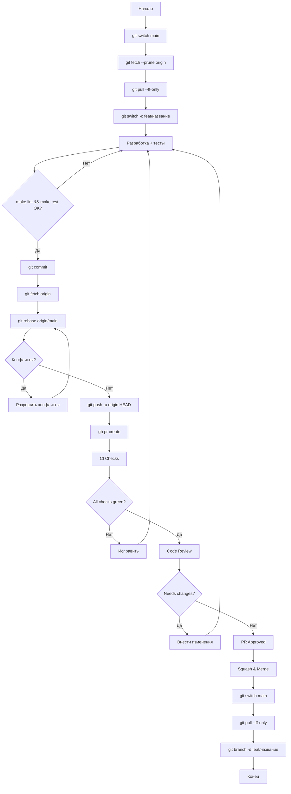
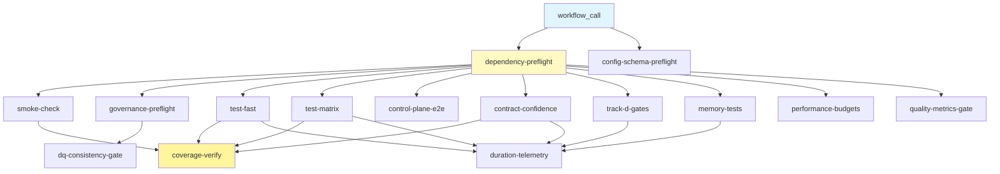
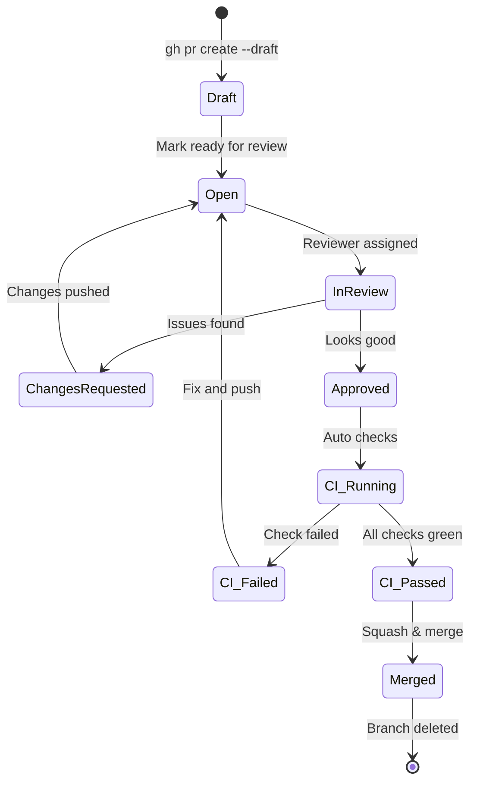
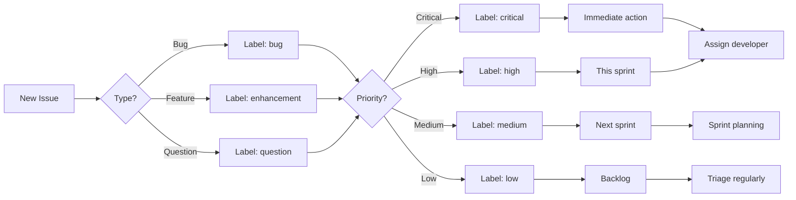
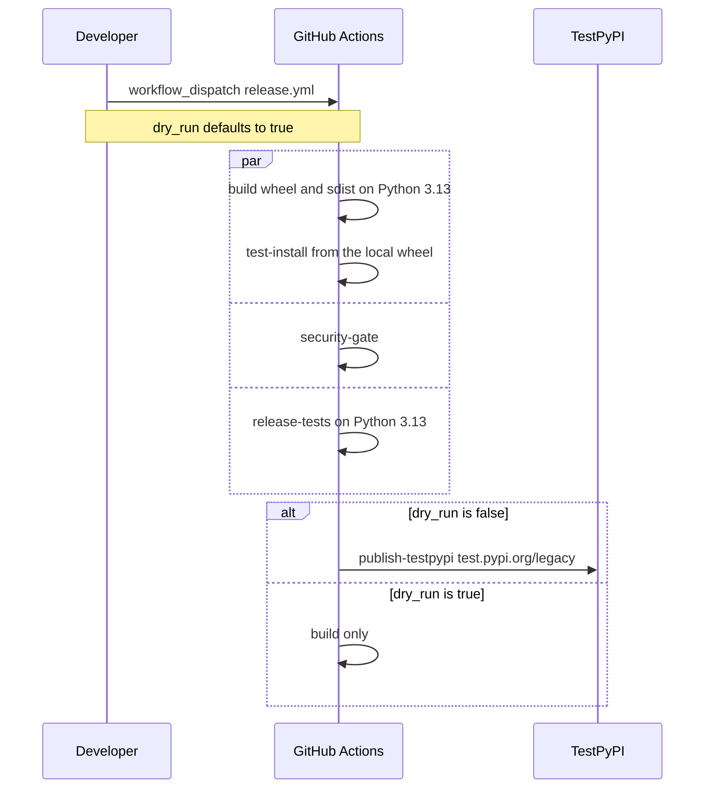
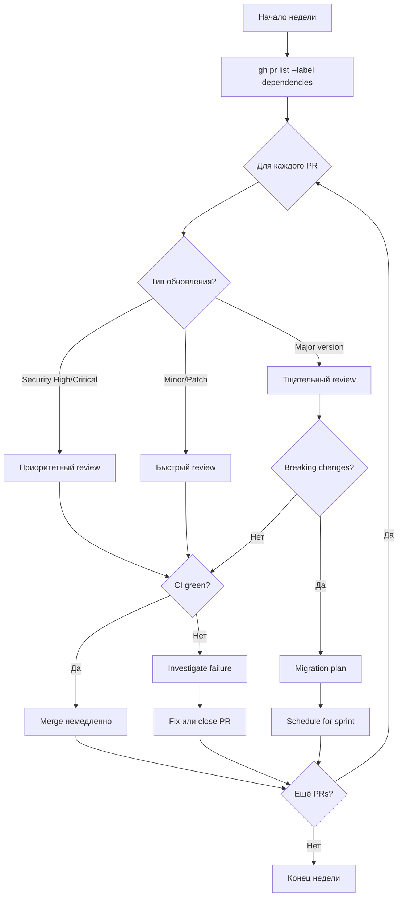
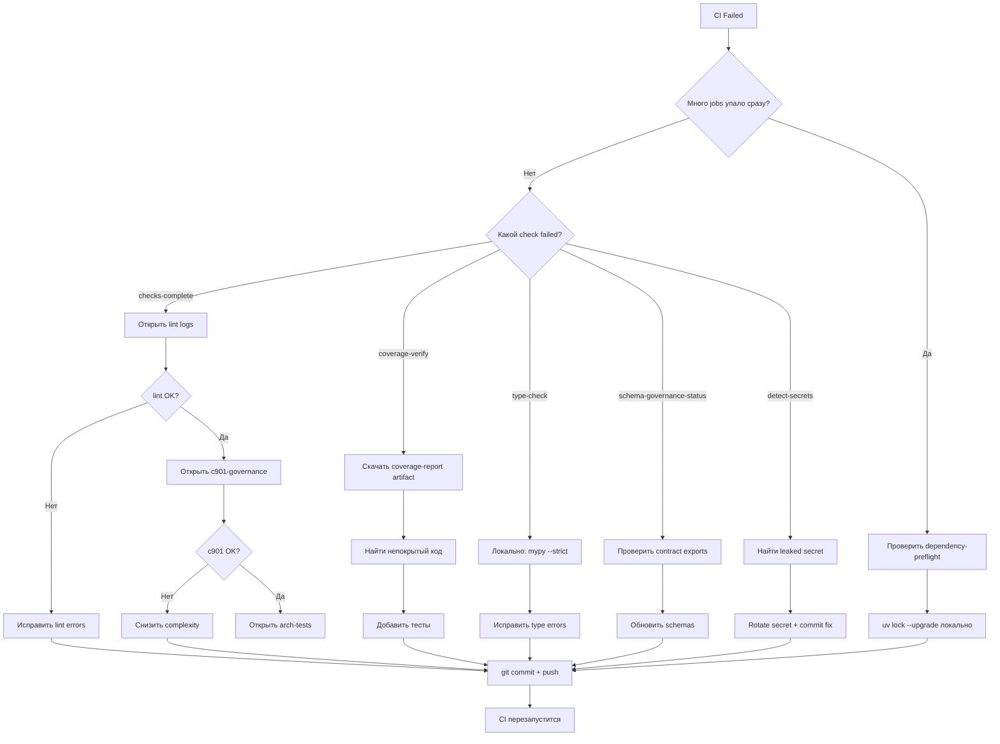
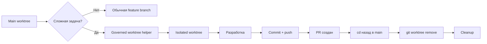

# GitHub Workflow Визуализация для BioETL

## Feature Development Flow

## CI Pipeline Structure

Рёбра совпадают с ключами `needs` в `.github/workflows/tests.yml` для jobs на схеме. `dependency-preflight` и `config-schema-preflight` не объявляют `needs`. `coverage-verify` также ждёт `repo-backed-unit`, `unit-scripts-tooling`, `unit-filesystem-contracts`, `unit-subprocess-backed` и `serial-coverage`. `duration-telemetry` также ждёт `flaky-telemetry`, `repo-backed-unit`, `serial-coverage` и те же `unit-*` jobs.

## PR Lifecycle

## Issue Triage Flow

## Release Workflow

`release.yml` запускается только через `workflow_dispatch`. `test-install` ждёт `build` и ставит локальное wheel. `security-gate` и `release-tests` не объявляют `needs`. `publish-testpypi` ждёт `build`, `test-install`, `security-gate` и `release-tests` и публикует в `https://test.pypi.org/legacy/` только при `dry_run=false`.

## Dependabot Weekly Triage

## CI Troubleshooting Decision Tree

## Git Worktree Usage Pattern

---

**Примечание:** Все диаграммы используют Mermaid синтаксис и совместимы с GitHub, MkDocs, и другими markdown рендерерами с поддержкой Mermaid.

